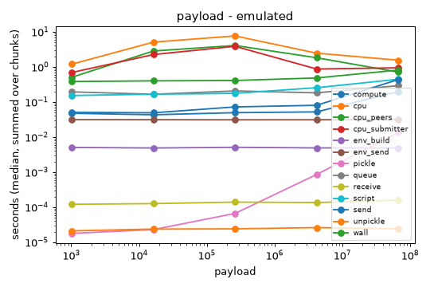
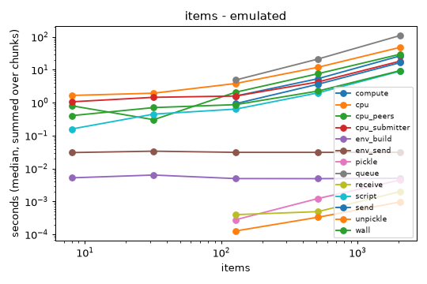
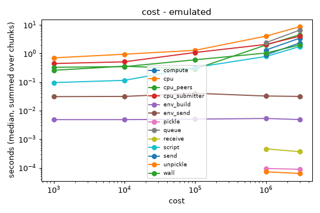
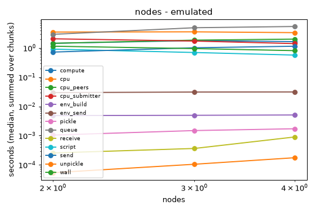
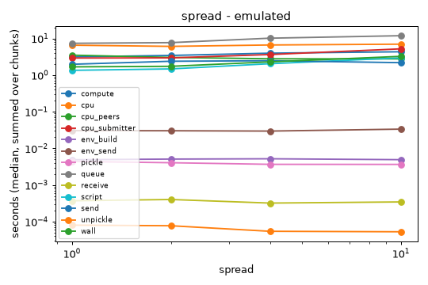

# Scaling map: data path (M2)

Every number here is **emulated**: equal cgroup CPU quotas plus tc netem on one
15-core host (`scripts/lab-emu.sh`, LAB_NAME=m2), never real-hardware speedup.
Binary fc83359, built from `git archive` (CGO_ENABLED=0); nodes 2 CPU / 768m
each, 3 nodes unless the variable is the node count; 3 reps per cell, medians.

Reproduce: `scripts/scaling/sweep.sh [payload items cost profile loss nodes spread cold]`,
then `scripts/scaling/sweep.sh table` (runs `scripts/scaling/fit.py`; its test is
`uvx --with numpy pytest scripts/scaling/test_fit.py`). Raw rows:
`~/.local/state/pipedpeer/bench/m2/{results,cpu}.csv`, one log and steps.json per run.

## Method

- Workload: `Pool.map` over items, a module-level kernel in `__main__` (shipped
  as source), per-item cost = loop iterations, per-item payload = random bytes.
  Fixed point: 64 items x 1e6 iterations (~75 ms) x 256 KB. Payload sweep: 16
  items, tiny compute, `PIPEDPEER_DISTRIBUTE=force` (auto keeps it local).
- One variable at a time; per step the run record (C24 steps.json) is summed
  over chunks; growth is the log-log slope of the median against the variable,
  over the whole range and over the top three points.
- **Flags use CPU time, not wall time.** Parallel agents loaded the host (1-min
  load 0.4-4 during these runs, recorded per row as `load`), so wall-clock
  steps are inflated unevenly. `cpu` = cgroup `usage_usec` delta of every lab
  container over the run (daemon + shim + workers); `cpu_submitter` = node 1,
  `cpu_peers` = the rest. Only total `cpu` can flag (the split moves with
  placement). A flag = exponent > expected + 0.15. Wall-clock step exponents
  are shown as hints.
- Node count fits start at 2: 1 -> 2 is the fixed cost of distributing
  (cpu 2.5 -> 3.5 s), not growth.
- **Paper wall times come from a quiet rerun** (QUIET-RERUN): on an idle host,
  `BL_OUT=<fresh dir> M2_MEM=768m BL_RUN_TIMEOUT=1500 M2_BIN=<binary> scripts/scaling/sweep.sh payload items cost profile loss nodes spread cold`
  reruns exactly these rows; then `BL_OUT=<same> scripts/scaling/sweep.sh table`.

## Findings

- **No superlinear CPU growth** in any numeric sweep (payload 1 KB-64 MB, items
  8-2048, cost 1e3-3e6, nodes 2-4, spread 1-10x).
- items: compute, pickle, send all +1.00 to +1.03; total CPU +0.91 over the top
  three points. Queue (wall, summed over chunks) +1.12, inside the margin.
- nodes: wall 2.37 s (1 node) -> 1.15 / 0.95 / 0.81 s (2 / 3 / 4): 2.9x on 4
  equal nodes for a 2.5 CPU-s map (emulated, loaded host). Total CPU flat from 2
  to 4 nodes (-0.06).
- spread: one peer at 0.2 CPU (10x slower) takes wall 1.68 -> 3.25 s (1.9x)
  where lost capacity alone predicts ~1.4x (6 -> 4.2 CPUs): a straggler tail;
  CPU flat (+0.08). Wall only, so re-check in the quiet rerun.
- loss: 5% loss moves work back to the submitter (peers 3.0 -> 1.7 CPU-s,
  submitter 2.7 -> 5.4) and wall 1.6 -> 2.9 s; 0-2% costs little.
- cost: below ~1e5 iterations per item the shim keeps the map local (no pool
  steps at all), as designed. The `send` step grows +0.87 with per-item cost
  although bytes are fixed: send appears to include waiting on the peer, so
  it is not a pure transfer time (record definition, not a cost).
- payload: a 256 MB map fails on a 768m submitter (memory; 64 MB is the top
  measured point); send +0.32 over the top three points (latency-bound below
  4 MB); total CPU noise-dominated (~1-8 s, non-monotonic).
- **cold: closure broadcast blocks ~600 s.** A fresh lab: cold run env_build
  212 s + env_send 603 s; the **warm run right after still pays env_send 579 s**,
  and the third cold rep timed out at 1500 s. The run logs show each peer's
  `/v1/store/import` hitting the 10-minute client timeout ("Client.Timeout
  exceeded while awaiting headers"): the upload reply waits on the synchronous
  broadcast, and a peer still importing from the last run is asked again.
  Logs: `~/.local/state/pipedpeer/bench/m2/logs/cold_*_r{1,2,3}.log`.
  (Cold rows ran with the earlier 1e5-iteration base, which stays local; the
  cost is environment shipping, which the base does not change.)
- Run record: peer `compute` steps carry Machine = the submitter's id and Node =
  the peer's (e.g. items_2048 r1: `compute ca07da/33d15c` x4); `names` lists only
  the submitter, so "where it ran" credits peer work to the submitter.

## Tables and fits

### payload (emulated)

| payload | runs | compute | cpu | cpu_peers | cpu_submitter | env_build | env_send | load | pickle | queue | receive | script | send | unpickle | wall |
|---|---|---|---|---|---|---|---|---|---|---|---|---|---|---|---|
| 1024 | 3 | 0.047 | 1.196 | 0.506 | 0.690 | 0.005 | 0.031 | 1.260 | 0.000 | 0.193 | 0.000 | 0.152 | 0.051 | 0.000 | 0.381 |
| 16384 | 3 | 0.043 | 5.067 | 2.828 | 2.239 | 0.005 | 0.031 | 0.940 | 0.000 | 0.165 | 0.000 | 0.166 | 0.049 | 0.000 | 0.398 |
| 262144 | 3 | 0.049 | 7.599 | 4.056 | 3.846 | 0.005 | 0.031 | 0.650 | 0.000 | 0.205 | 0.000 | 0.175 | 0.072 | 0.000 | 0.408 |
| 4194304 | 3 | 0.052 | 2.454 | 1.814 | 0.866 | 0.005 | 0.031 | 0.650 | 0.001 | 0.181 | 0.000 | 0.254 | 0.080 | 0.000 | 0.482 |
| 67108864 | 3 | 0.196 | 1.546 | 0.708 | 0.937 | 0.005 | 0.031 | 1.310 | 0.013 | 0.290 | 0.000 | 0.442 | 0.433 | 0.000 | 0.808 |

| step | exponent (whole) | exponent (top 3) | expected | superlinear |
|---|---|---|---|---|
| compute | +0.11 | +0.25 | +0.0 | wall only (load-inflated; not flagged) |
| cpu | -0.01 | -0.29 | +1.0 | no |
| cpu_peers | +0.01 | -0.31 | +1.0 | no |
| cpu_submitter | -0.01 | -0.25 | +1.0 | no |
| env_build | -0.00 | -0.01 | +0.0 | no |
| env_send | +0.00 | +0.00 | +0.0 | no |
| pickle | +0.61 | +0.96 | +1.0 | no |
| queue | +0.03 | +0.06 | +0.0 | no |
| receive | +0.02 | +0.02 | +1.0 | no |
| script | +0.09 | +0.17 | +0.0 | wall only (load-inflated; not flagged) |
| send | +0.17 | +0.32 | +1.0 | no |
| unpickle | +0.01 | +0.00 | +1.0 | no |
| wall | +0.06 | +0.12 | +0.0 | no |

### items (emulated)

| items | runs | compute | cpu | cpu_peers | cpu_submitter | env_build | env_send | load | pickle | queue | receive | script | send | unpickle | wall |
|---|---|---|---|---|---|---|---|---|---|---|---|---|---|---|---|
| 8 | 3 | 0.000 | 1.666 | 0.808 | 1.066 | 0.005 | 0.031 | 3.850 | 0.000 | 0.000 | 0.000 | 0.159 | 0.000 | 0.000 | 0.405 |
| 32 | 3 | 0.000 | 1.947 | 0.305 | 1.459 | 0.006 | 0.034 | 3.780 | 0.000 | 0.000 | 0.000 | 0.451 | 0.000 | 0.000 | 0.712 |
| 128 | 3 | 1.598 | 3.837 | 2.089 | 1.596 | 0.005 | 0.031 | 2.180 | 0.000 | 4.901 | 0.000 | 0.640 | 0.939 | 0.000 | 0.874 |
| 512 | 3 | 5.352 | 11.895 | 7.586 | 4.271 | 0.005 | 0.031 | 1.680 | 0.001 | 21.157 | 0.000 | 1.988 | 3.635 | 0.000 | 2.258 |
| 2048 | 3 | 26.311 | 47.839 | 29.621 | 18.218 | 0.005 | 0.031 | 1.360 | 0.004 | 109.421 | 0.002 | 9.101 | 16.412 | 0.001 | 9.384 |

| step | exponent (whole) | exponent (top 3) | expected | superlinear |
|---|---|---|---|---|
| compute | +1.01 | +1.01 | +1.0 | no |
| cpu | +0.61 | +0.91 | +1.0 | no |
| cpu_peers | +0.75 | +0.96 | +1.0 | no |
| cpu_submitter | +0.49 | +0.88 | +1.0 | no |
| env_build | -0.02 | +0.01 | +0.0 | no |
| env_send | -0.00 | +0.00 | +0.0 | no |
| pickle | +1.00 | +1.00 | +1.0 | no |
| queue | +1.12 | +1.12 | +1.0 | no |
| receive | +0.58 | +0.58 | +1.0 | no |
| script | +0.69 | +0.96 | +0.0 | wall only (load-inflated; not flagged) |
| send | +1.03 | +1.03 | +1.0 | no |
| unpickle | +0.73 | +0.73 | +1.0 | no |
| wall | +0.54 | +0.86 | +1.0 | no |

### cost (emulated)

| cost | runs | compute | cpu | cpu_peers | cpu_submitter | env_build | env_send | load | pickle | queue | receive | script | send | unpickle | wall |
|---|---|---|---|---|---|---|---|---|---|---|---|---|---|---|---|
| 1000 | 3 | 0.000 | 0.704 | 0.259 | 0.445 | 0.005 | 0.031 | 2.330 | 0.000 | 0.000 | 0.000 | 0.096 | 0.000 | 0.000 | 0.329 |
| 10000 | 3 | 0.000 | 0.944 | 0.359 | 0.512 | 0.005 | 0.031 | 1.900 | 0.000 | 0.000 | 0.000 | 0.115 | 0.000 | 0.000 | 0.348 |
| 100000 | 3 | 0.000 | 1.294 | 0.287 | 1.087 | 0.005 | 0.041 | 2.260 | 0.000 | 0.000 | 0.000 | 0.324 | 0.000 | 0.000 | 0.603 |
| 1000000 | 3 | 1.326 | 4.055 | 1.978 | 2.077 | 0.005 | 0.032 | 2.470 | 0.000 | 2.393 | 0.000 | 0.788 | 0.901 | 0.000 | 1.038 |
| 3000000 | 3 | 3.432 | 8.688 | 4.536 | 4.029 | 0.005 | 0.032 | 2.090 | 0.000 | 6.618 | 0.000 | 1.753 | 2.334 | 0.000 | 1.987 |

| step | exponent (whole) | exponent (top 3) | expected | superlinear |
|---|---|---|---|---|
| compute | +0.87 | +0.87 | +1.0 | no |
| cpu | +0.31 | +0.55 | +1.0 | no |
| cpu_peers | +0.35 | +0.82 | +1.0 | no |
| cpu_submitter | +0.28 | +0.37 | +1.0 | no |
| env_build | +0.01 | -0.00 | +0.0 | no |
| env_send | +0.01 | -0.08 | +0.0 | no |
| pickle | -0.06 | -0.06 | +0.0 | no |
| queue | +0.93 | +0.93 | +0.0 | wall only (load-inflated; not flagged) |
| receive | -0.21 | -0.21 | +0.0 | no |
| script | +0.37 | +0.48 | +0.0 | wall only (load-inflated; not flagged) |
| send | +0.87 | +0.87 | +0.0 | wall only (load-inflated; not flagged) |
| unpickle | -0.12 | -0.12 | +0.0 | no |
| wall | +0.22 | +0.33 | +1.0 | no |

### nodes (emulated)

| nodes | runs | compute | cpu | cpu_peers | cpu_submitter | env_build | env_send | load | pickle | queue | receive | script | send | unpickle | wall |
|---|---|---|---|---|---|---|---|---|---|---|---|---|---|---|---|
| 1 | 3 | 0.000 | 2.535 | 0.000 | 2.535 | 0.005 | 1.015 | 2.530 | 0.000 | 0.000 | 0.000 | 1.143 | 0.000 | 0.000 | 2.370 |
| 2 | 3 | 1.438 | 3.496 | 1.444 | 2.053 | 0.005 | 0.030 | 0.960 | 0.001 | 2.923 | 0.000 | 0.908 | 0.722 | 0.000 | 1.146 |
| 3 | 3 | 1.789 | 3.553 | 1.850 | 1.720 | 0.005 | 0.031 | 0.440 | 0.001 | 4.910 | 0.000 | 0.698 | 1.013 | 0.000 | 0.950 |
| 4 | 3 | 1.644 | 3.337 | 2.005 | 1.407 | 0.005 | 0.031 | 0.660 | 0.002 | 5.419 | 0.001 | 0.570 | 1.144 | 0.000 | 0.808 |

| step | exponent (whole) | exponent (top 3) | expected | superlinear |
|---|---|---|---|---|
| compute | +0.22 | - | +0.0 | wall only (load-inflated; not flagged) |
| cpu | -0.06 | - | +0.0 | no |
| cpu_peers | +0.48 | - | +0.0 | split only (placement; not flagged) |
| cpu_submitter | -0.54 | - | +0.0 | no |
| env_build | +0.07 | - | +0.0 | no |
| env_send | +0.08 | - | +0.0 | no |
| pickle | +0.73 | - | +0.0 | wall only (load-inflated; not flagged) |
| queue | +0.92 | - | +0.0 | wall only (load-inflated; not flagged) |
| receive | +1.75 | - | +0.0 | wall only (load-inflated; not flagged) |
| script | -0.67 | - | +0.0 | no |
| send | +0.68 | - | +0.0 | wall only (load-inflated; not flagged) |
| unpickle | +1.70 | - | +0.0 | wall only (load-inflated; not flagged) |
| wall | -0.50 | - | -1.0 | wall only (load-inflated; not flagged) |

### spread (emulated)

| spread | runs | compute | cpu | cpu_peers | cpu_submitter | env_build | env_send | load | pickle | queue | receive | script | send | unpickle | wall |
|---|---|---|---|---|---|---|---|---|---|---|---|---|---|---|---|
| 1 | 3 | 3.136 | 6.544 | 3.497 | 2.921 | 0.005 | 0.030 | 0.410 | 0.004 | 7.367 | 0.000 | 1.347 | 1.972 | 0.000 | 1.677 |
| 2 | 3 | 3.439 | 6.072 | 3.037 | 2.950 | 0.005 | 0.030 | 1.260 | 0.004 | 7.686 | 0.000 | 1.474 | 2.385 | 0.000 | 1.735 |
| 4 | 3 | 3.963 | 6.631 | 2.782 | 3.637 | 0.005 | 0.030 | 0.770 | 0.004 | 10.162 | 0.000 | 2.042 | 2.464 | 0.000 | 2.294 |
| 10 | 3 | 4.328 | 6.977 | 2.768 | 5.204 | 0.005 | 0.034 | 1.930 | 0.004 | 11.884 | 0.000 | 2.950 | 2.183 | 0.000 | 3.248 |

| step | exponent (whole) | exponent (top 3) | expected | superlinear |
|---|---|---|---|---|
| compute | +0.14 | +0.14 | +0.0 | no |
| cpu | +0.04 | +0.08 | +0.0 | no |
| cpu_peers | -0.10 | -0.05 | +0.0 | no |
| cpu_submitter | +0.26 | +0.35 | +0.0 | split only (placement; not flagged) |
| env_build | +0.00 | -0.02 | +0.0 | no |
| env_send | +0.04 | +0.07 | +0.0 | no |
| pickle | -0.09 | -0.06 | +0.0 | no |
| queue | +0.23 | +0.27 | +0.0 | wall only (load-inflated; not flagged) |
| receive | -0.06 | -0.09 | +0.0 | no |
| script | +0.36 | +0.43 | +0.0 | wall only (load-inflated; not flagged) |
| send | +0.04 | -0.06 | +0.0 | no |
| unpickle | -0.21 | -0.22 | +0.0 | no |
| wall | +0.30 | +0.39 | +0.0 | wall only (load-inflated; not flagged) |

### cold (emulated)

| cold | runs | cpu | cpu_peers | cpu_submitter | env_build | env_send | load | script | wall |
|---|---|---|---|---|---|---|---|---|---|
| cold | 2 | 110.679 | 31.401 | 79.279 | 212.105 | 603.339 | 0.485 | 0.348 | 816.138 |
| warm | 2 | 34.525 | 24.407 | 10.117 | 0.005 | 579.064 | 0.115 | 0.365 | 579.712 |

### loss (emulated)

| loss | runs | compute | cpu | cpu_peers | cpu_submitter | env_build | env_send | load | pickle | queue | receive | script | send | unpickle | wall |
|---|---|---|---|---|---|---|---|---|---|---|---|---|---|---|---|
| 0 | 3 | 2.927 | 5.729 | 3.016 | 2.712 | 0.005 | 0.031 | 1.580 | 0.004 | 7.267 | 0.000 | 1.339 | 1.936 | 0.000 | 1.595 |
| 1 | 3 | 2.392 | 5.742 | 3.112 | 2.797 | 0.005 | 0.031 | 1.610 | 0.004 | 6.352 | 0.000 | 1.474 | 1.897 | 0.000 | 1.727 |
| 2 | 3 | 2.588 | 5.895 | 3.316 | 2.756 | 0.005 | 0.031 | 1.610 | 0.004 | 8.817 | 0.000 | 1.437 | 1.957 | 0.000 | 1.825 |
| 5 | 3 | 2.896 | 7.166 | 1.726 | 5.440 | 0.005 | 0.031 | 1.690 | 0.004 | 8.977 | 0.000 | 2.647 | 1.893 | 0.000 | 2.898 |

### profile (emulated)

| profile | runs | compute | cpu | cpu_peers | cpu_submitter | env_build | env_send | load | pickle | queue | receive | script | send | unpickle | wall |
|---|---|---|---|---|---|---|---|---|---|---|---|---|---|---|---|
| 5g | 3 | 2.497 | 6.102 | 2.528 | 3.574 | 0.005 | 0.093 | 0.920 | 0.004 | 10.693 | 0.000 | 1.851 | 2.514 | 0.000 | 2.253 |
| lan | 3 | 2.533 | 5.847 | 3.247 | 2.594 | 0.005 | 0.030 | 0.810 | 0.004 | 7.019 | 0.001 | 1.186 | 1.680 | 0.000 | 1.465 |
| wifi | 3 | 2.752 | 6.099 | 2.695 | 3.405 | 0.005 | 0.045 | 0.830 | 0.004 | 10.999 | 0.000 | 1.597 | 2.456 | 0.000 | 1.879 |

### Superlinear CPU growth (exponent > expected + 0.15)

- none
