# Lab campaign: what the data and the report will look like

**Every number in this file is emulated, from the container lab, at sample sizes. None is a result.** This is a dry run of the lab day's pipeline on three 1 GB containers on one laptop (`LAB_NAME=sample`). The runner, telemetry and analysis are the real ones. The goal was to see, before the lab, what data the day produces, what the paper's figures and tables would look like, and what is missing.

- Interactive: [dashboard.html](dashboard.html) is one file with the data inlined; open it in a browser.
- Paper figures: [figures/](figures/), each as PNG (300 dpi) and PDF.
- Regenerate them: `scripts/campaign/sample_figures.py --html` (see [How it was made](#how-it-was-made)). The same command runs on the real day's `results/lab`.

## What ran

| Exp | Ran | Runs (failed) | Notes |
|---|---|---|---|
| E1/E2 | W1, W2, W3 × plain, pipedpeer, ray, dask × N = 1, 2; 3 repeats + 1 warm-up | 84 (5) | W2 pipedpeer N=2: exit 137, the OOM killer in a 1 GB container. W3 ray: 4 × exit 1 with no traceback in `output.log`; probably memory too |
| E1b | W1 weak, 2400 items per PC, N = 1, 2 | 28 (0) | |
| E4 | N = 2, caps 2/1 (the runner's rehearsal caps), measured vs even split vs ray vs dask | 16 (0) | |
| E6 | N = 2, one `kill -9` per system at 30%, one Ctrl-C | 10 (0) | |
| E7 | trivial.py, shim on vs off, 3 repeats | 8 (0) | |
| E8 | T1 mlp-c, 2 ranks, 1 seed, 1 epoch | 6 (0) | pipedpeer-fast's warm-up took 123 s: the first torch closure build |
| E3, E5, E9, E10, E11 | not run | | Out of scope here. E5 and E11 are in the runner's rehearsal; E3, E9 and E10 need a person or a second network |

The sizes were W1 `BENCH_ITEMS=2400`, W2 `CPU_ITEMS=8` and W3 `RF_TREES=40`, about 8 s plain on one container ([workloads-sample.json](workloads-sample.json)). `PL_NPROC=2`.

**Read this before any chart.** The containers have no CPU limit, so each one sees the laptop's 20 cores. `PL_NPROC=2` limits Ray, Dask and plain's `BENCH_PROCS` to 2 processes. PipedPeer's shim, however, widens the local pool to the cores it sees: it burned about 25 core-seconds in 2.6 s on pc00, where plain used 2 cores for 8 s (measured from the cgroup samples). That is why PipedPeer shows a "3.2× speedup at N = 1" on W1. It is an artefact of the container lab and goes away on real PCs, where every system sees the same cores. E4, where `taskset` caps every system the same way, is the only fair comparison in this sample: all four systems land at 22–24 s.

## 1. The data we get

Measured on this sample (152 runs, 3 PCs, 86 min of runs, about 90 min of telemetry). Projected to the minimal day: 17 PCs, 318 min (the 258 min in `profile-minimal.tsv` plus 60 min of setup and cleanup), 282 runs.

| Source | What is in it | Records (sample) | Bytes (sample) | Per run | Day, raw | Day, gzip |
|---|---|---|---|---|---|---|
| `runs.jsonl` | One line per run: ids, N, timings, `result_ok`, hosts, the receipt inline (by_where, parts, decisions, steps) | 152 | 8.0 MB | 52.7 kB | 15 MB (see gap 1: **≈ 1.1 GB at lab sizes**) | 1 MB (≈ 70 MB) |
| `logs/<run>/record.json` | `pipedpeer jobs last --export json`: env build/send, script, names | 58 | 38 kB | 252 B | 71 kB | 28 kB |
| `logs/<run>/output.log` | The script's stdout | 161 | 20 kB | 133 B | 37 kB | 37 kB |
| `logs/<exp>.log` | Runner log | 191 lines | 10 kB | 65 B | 18 kB | 5 kB |
| OTel host metrics | `host_metrics` every 1 s: cpu time by state, memory, network io/packets/errors/drops/connections, load; `lab.pc_id` | 720,630 datapoints | 183 MB | 1.2 MB | 3.7 GB | 118 MB |
| OTel logs | The daemon log per PC, plus a copy of every runs.jsonl line | 2,347 records | 32 MB | 209 kB | 641 MB (gap 1: **+1.1 GB**) | 28 MB |
| Process metrics | none: `node.yaml` has no `process` scraper | – | – | – | – | – |
| Ray and Dask metrics | none: not scraped | – | – | – | – | – |
| `clocks.txt` | Offset per PC from the driver, ± half the RTT | 3 PCs | 593 B | – | 3 kB | 2 kB |
| `machines.csv` | pc_id, ip, hostname, cores, RAM, OS, kernel, python, machine_id | 3 | 508 B | – | 3 kB | 2 kB |
| `network.csv` | iperf3 and ping from pc00 | not made (no iperf3 in the containers) | – | – | ≈ 2 kB | – |
| cgroup CPU | Per-container CPU (sample only, see gap 3) | 3,340 | 1.0 MB | – | not on the lab | – |

**The projection against the 8 GB R2 cap** ([scripts/campaign/ingest/README.md](../../../scripts/campaign/ingest/README.md)):

- The script's projection: 4.3 GB raw (without the sample-only cgroup line), 0.15 GB gzipped.
- The receipt steps at lab sizes add about 1.1 GB raw to runs.jsonl and the same again in the OTel log copy (gap 1). In total: **about 6.5 GB raw (81 % of the cap) and about 0.3 GB gzipped (4 %)**.
- `ingest.sh` gzips text before upload, so the stored figure is the gzipped one, well inside the cap.
- If the day instead uses `r2.env`, the `awss3` exporter writes `otlp_json` uncompressed and bypasses the Worker's cap. Its 4.4 GB of OTel data would then be stored raw (gap 9).

The full table, as the script writes it: [figures/volume.md](figures/volume.md).

## 2. Proposed figures for the paper

All figures share one palette, validated with the dataviz skill's `validate_palette.js --pairs all` in both light and dark modes. The three distributed systems take categorical slots 1–3: PipedPeer blue `#2a78d6`, Ray orange `#eb6834`, Dask aqua `#1baf7a`. Plain is the neutral grey reference `#898781`, always drawn hollow or hatched and labelled. Each system also has its own marker shape (PipedPeer ●, Ray ■, Dask ▲, plain ◇), so identity never rests on colour alone. Text is Liberation Sans (an Arial metric clone) at 6–8 pt, sized for a 3.5 in single column or a 7.16 in double column. Fonts are embedded in the PDFs as TrueType.

| Figure | Width | What it shows here | What it would show at lab scale |
|---|---|---|---|
| 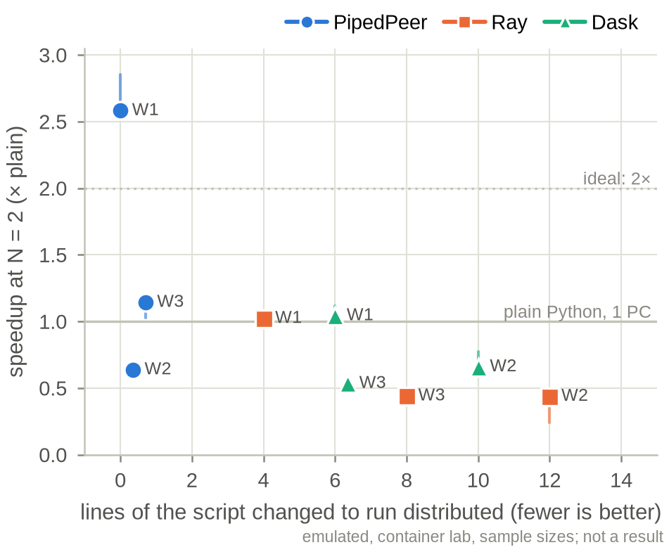 **fig_frontier**, the hero | single | Lines changed to the script (port-lines.csv) against speedup at the largest N, one marker per (system, workload), whiskers IQR. PipedPeer sits at x = 0 | The paper's one-figure argument: PipedPeer at 0 lines, the others at 4–12 lines, and where each lands on speedup at N = 16. If PipedPeer sits upper-left, the claim holds; if not, the figure says so plainly |
| 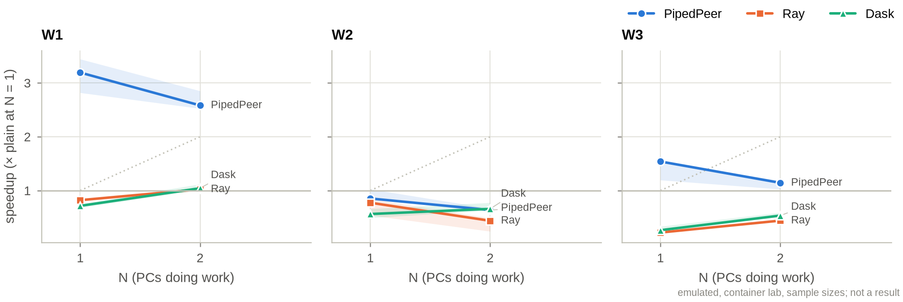 **fig_speedup** | double | Speedup over plain at N = 1 against N, one line per system, one panel per workload, IQR bands, ideal dotted | Strong scaling at N = 1, 4, 16 (log₂ x axis); where each system leaves the ideal line |
| 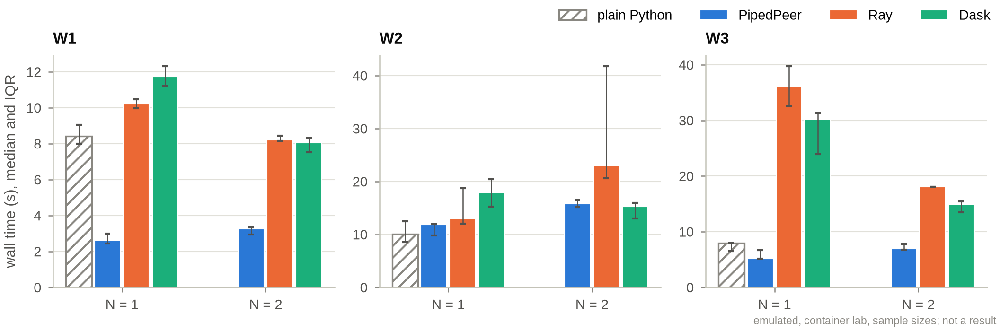 **fig_wall** | double | Median wall with IQR whiskers, grouped by N, one panel per workload | The raw numbers behind the speedups; spread across repeats |
| 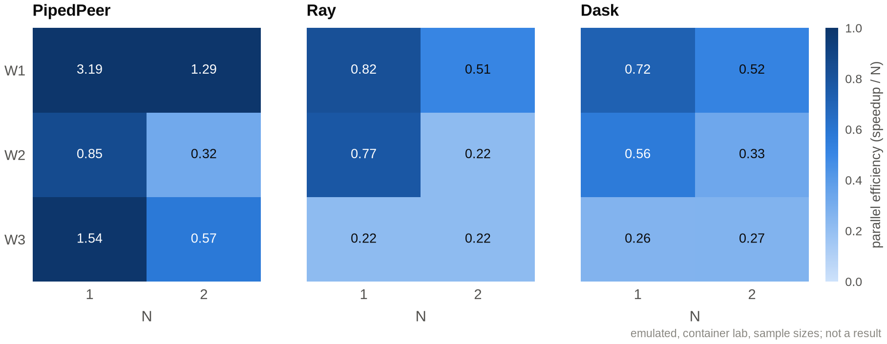 **fig_efficiency_heatmap** | double | Speedup / N, workload × N, one panel per system, single-hue blue ramp | Where each system's efficiency collapses as N grows. Values > 1 here are the container artefact above |
| 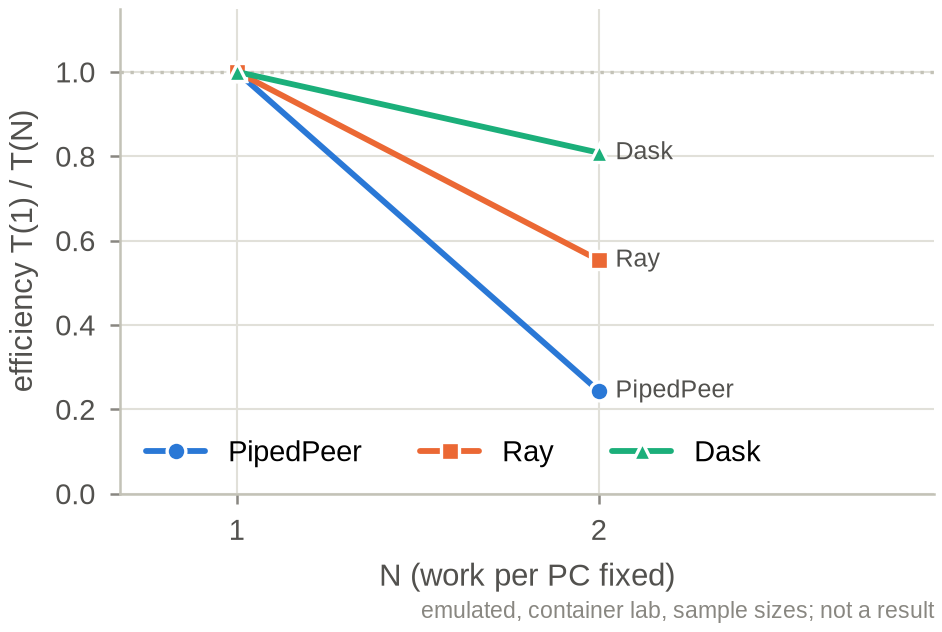 **fig_weak** | single | E1b T(1)/T(N) at fixed work per PC | Weak-scaling efficiency at N = 1, 4, 16 |
| 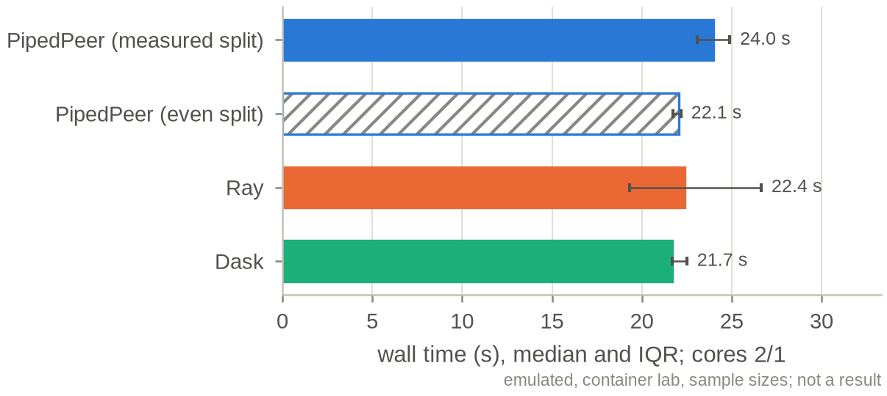 **fig_e4** | single | E4: measured split, even split (hatched), Ray, Dask under caps 2/1 | Caps 8/4/2/1 at N = 4: whether the measured split beats the even split it replaced |
| 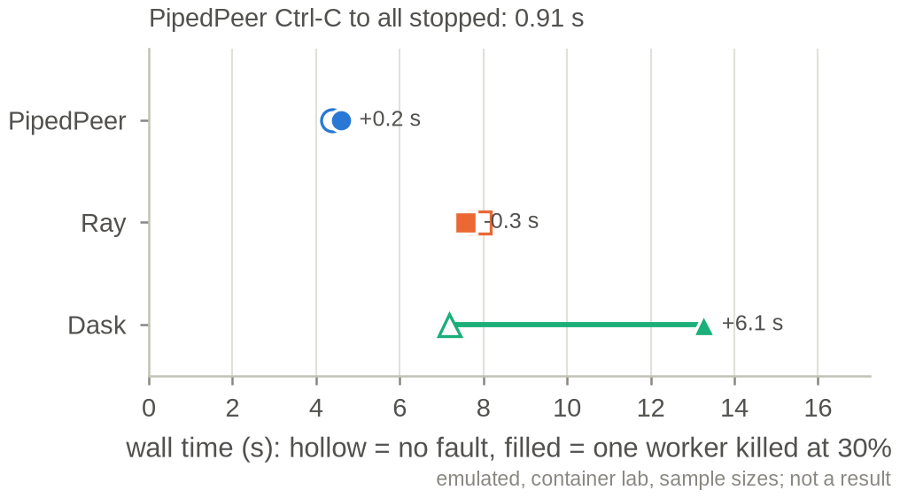 **fig_e6** | single | Wall with no fault (hollow) and with one worker killed at 30 % (filled); Ctrl-C to all-stopped in the title | The cost of losing one of 16 workers per system, with a correct result; Ctrl-C latency |
| 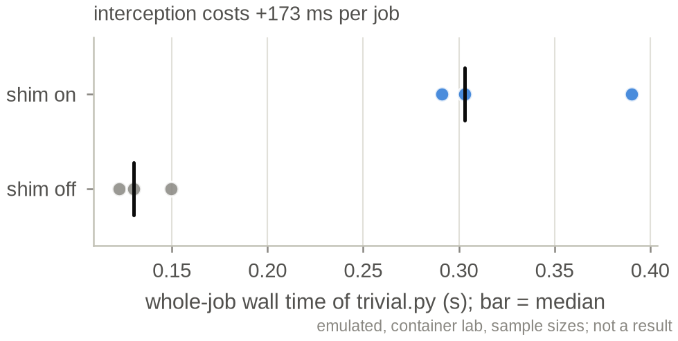 **fig_e7** | single | trivial.py whole-job wall, shim on and off, every repeat plus the median | Interception overhead per job on a lab PC (R3's method) |
| 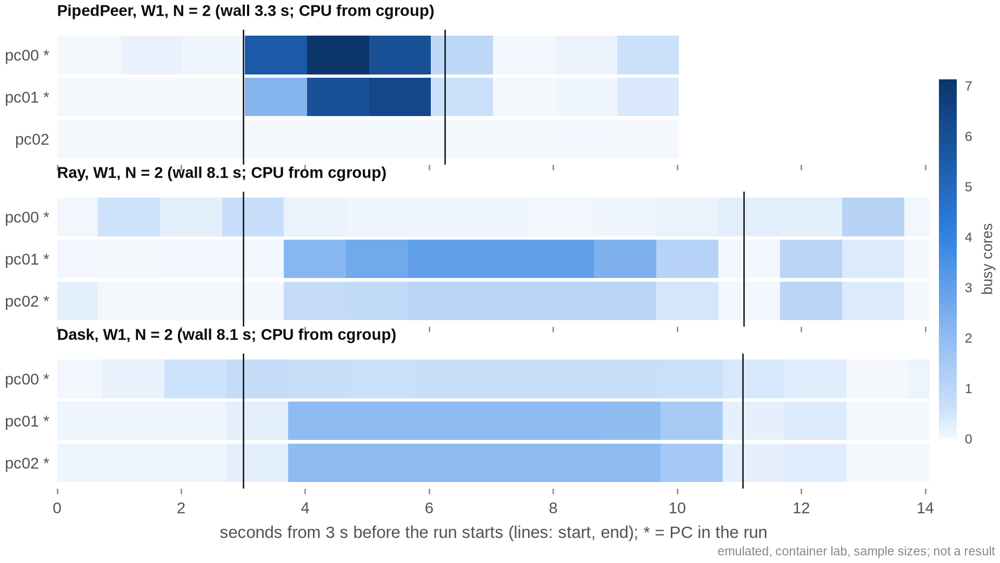 **fig_cpu_heatmap** | double | Busy cores per PC over one W1 run at the largest N, PipedPeer / Ray / Dask stacked, from the OTel CPU samples (cgroup in the sample) | 17 rows per system: work spreading to PCs and the tail where PCs go idle. In the sample, Ray's head on pc00 sits near idle while PipedPeer's pc00 works |
| 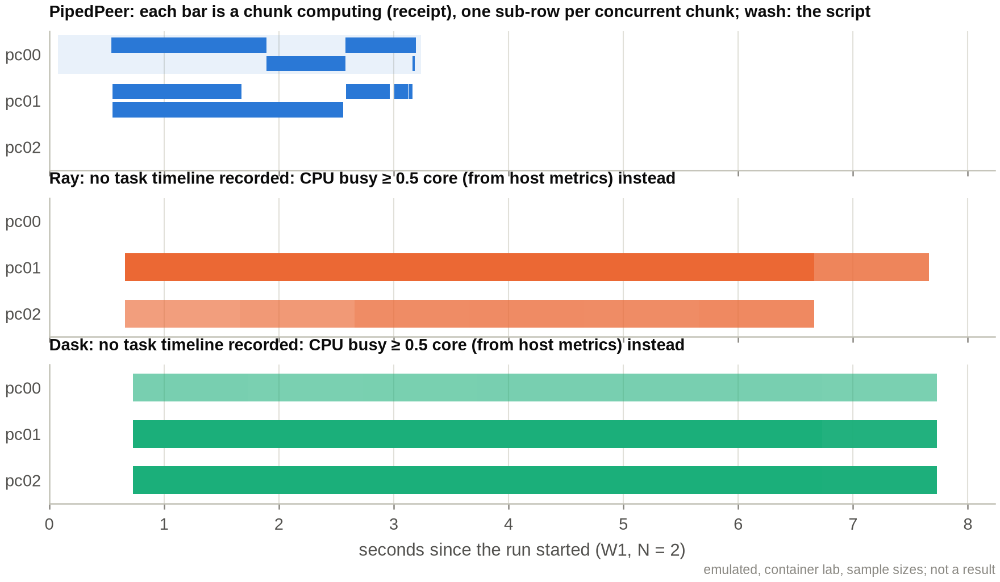 **fig_swimlanes** | double | Where work ran: each chunk's `compute` step on each PC (receipt steps), one sub-row per concurrent chunk. Ray and Dask record no task timeline, so their lanes are CPU activity (gap 4) | Item placement and stragglers across 16 PCs, side by side for the three systems once gap 4 is fixed |
| 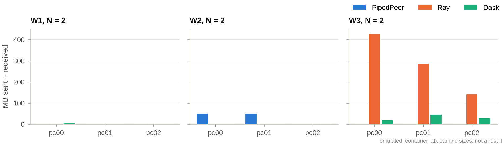 **fig_net_bytes** | double | MB sent + received per PC during one run per system at the largest N | Network cost per PC. Here Ray moved about 430 MB through pc00 on W3, against tens of MB for the others |
| [figures/anim_cluster_replay.gif](figures/anim_cluster_replay.gif) ([mp4](figures/anim_cluster_replay.mp4)) **cluster replay** | slides | Every PC's busy cores through one W1 run, the three systems side by side, 4 frames per second | The talk's opening slide: 16 bars filling and draining |
| [figures/e8_table.md](figures/e8_table.md), [figures/port_lines.md](figures/port_lines.md) | tables | E8 and port lines (below) | |

The figure list as cells (when a figure's data is missing, its caption goes to `figures/skipped.txt`): frontier, speedup, wall, efficiency heatmap, weak, E4, E6, E7, CPU heatmap, swimlanes, network bytes, replay (GIF and MP4), E8 table, port-lines table.

**The dashboard** ([dashboard.html](dashboard.html), 190 kB, no server, light and dark):

- The frontier.
- A scaling view with an N slider.
- Small multiples for every workload.
- The efficiency heatmap.
- E4, E6 and E7 as dot plots.
- A run picker: for the representative (median-wall) run of each group, it shows the per-PC CPU heatmap, the chunk swimlane, network bytes per PC, and a ▶ Replay button that sweeps a playhead with live per-PC bars.
- The full table of groups.

Every mark has a hover tooltip. Every chart has a table, inline or in "Table". Identity uses markers and direct labels as well as colour.

## 3. Tables in the paper's shape

The tables give median wall in seconds [IQR] over the repeats. Warm-ups and failed runs are excluded, and counted in the used, warm-ups and failed columns. Speedup is the median of plain at N = 1 divided by the median at N. The full set, every experiment: [figures/tables.md](figures/tables.md).

**E1, strong scaling** (emulated, container lab, sample sizes; not a result)

| Workload | System | N | Wall s, median [IQR] | Speedup | Used | Warm-ups | Failed |
|---|---|---|---|---|---|---|---|
| W1 | plain | 1 | 8.40 [8.00–9.03] | 1.00 | 3 | 1 | 0 |
| W1 | pipedpeer | 1 | 2.63 [2.44–2.98] | 3.19 | 3 | 1 | 0 |
| W1 | pipedpeer | 2 | 3.25 [2.95–3.33] | 2.58 | 3 | 1 | 0 |
| W1 | ray | 1 | 10.23 [9.97–10.47] | 0.82 | 3 | 1 | 0 |
| W1 | ray | 2 | 8.21 [8.14–8.43] | 1.02 | 3 | 1 | 0 |
| W1 | dask | 1 | 11.74 [11.21–12.30] | 0.72 | 3 | 1 | 0 |
| W1 | dask | 2 | 8.05 [7.51–8.30] | 1.04 | 3 | 1 | 0 |
| W2 | plain | 1 | 10.09 [8.59–12.47] | 1.00 | 3 | 1 | 0 |
| W2 | pipedpeer | 1 | 11.83 [9.83–11.98] | 0.85 | 3 | 1 | 0 |
| W2 | pipedpeer | 2 | 15.82 [15.14–16.50] | 0.64 | 2 | 1 | 1 |
| W2 | ray | 1 | 13.03 [12.01–18.71] | 0.77 | 3 | 1 | 0 |
| W2 | ray | 2 | 23.00 [20.60–41.76] | 0.44 | 3 | 1 | 0 |
| W2 | dask | 1 | 17.88 [15.27–20.44] | 0.56 | 3 | 1 | 0 |
| W2 | dask | 2 | 15.28 [13.02–15.98] | 0.66 | 3 | 1 | 0 |
| W3 | plain | 1 | 7.96 [6.49–7.99] | 1.00 | 3 | 1 | 0 |
| W3 | pipedpeer | 1 | 5.17 [5.17–6.67] | 1.54 | 3 | 1 | 0 |
| W3 | pipedpeer | 2 | 6.96 [6.75–7.77] | 1.14 | 3 | 1 | 0 |
| W3 | ray | 1 | 36.16 [32.61–39.72] | 0.22 | 2 | 1 | 1 |
| W3 | ray | 2 | 18.05 [18.05–18.05] | 0.44 | 1 | 1 | 2 |
| W3 | dask | 1 | 30.20 [23.94–31.31] | 0.26 | 3 | 1 | 0 |
| W3 | dask | 2 | 14.89 [13.48–15.40] | 0.54 | 3 | 1 | 0 |

**E4, uneven PCs** (caps 2/1, N = 2): pipedpeer measured split 23.97 [23.10–24.89]; even split 22.07 [21.74–22.17]; ray 22.38 [19.31–26.64]; dask 21.71 [21.70–22.50]. 3 used each, 1 warm-up each, 0 failed.

**E6, one worker killed at 30 %** (N = 2, one kill each):

| System | No fault, wall s | Killed, wall s | Result still right |
|---|---|---|---|
| pipedpeer | 4.38 | 4.59 (+0.2) | yes |
| ray | 7.90 | 7.56 (−0.3) | yes |
| dask | 7.18 | 13.26 (+6.1) | yes |

PipedPeer Ctrl-C to all stopped: 0.91 s.

**E7, interception overhead**: shim on 0.30 [0.30–0.35] s, shim off 0.13 [0.13–0.14] s, a difference of +173 ms per job. 3 repeats each.

**E8, CPU training** (mlp-c, 2 ranks, seed 1, 1 epoch):

| System | Wall s | Val loss | Loss vs 1 rank | Bytes sent per rank |
|---|---|---|---|---|
| pipedpeer-exact | 8.64 | 0.0993 | – (gap 6) | 19,235,383 |
| pipedpeer-fast | 7.78 | 0.0997 | – | 8,500,196 |
| torchrun | 11.41 | 0.0977 | – | 68,433,060 |

**Port lines** ([results/lab/port-lines.csv](../port-lines.csv)): W1 ray 4, dask 6; W2 ray 12, dask 10; W3 ray 8, dask 6; T1 torchrun 18; PipedPeer and plain 0 everywhere.

## 4. Gaps: what the lab-scale figures would lack, and the fix

The point of the sample. Each gap names its owner. I fixed the ones in my own files and list the rest precisely.

| # | Gap | Effect at lab scale | Fix | Owner |
|---|---|---|---|---|
| 1 | **The receipt carries one `pickle` and one `unpickle` step per item, with no cap** (`src/internal/nixgen/shim/pipedpeer_shim/record.py` `step()`), and the runner inlines the whole receipt into runs.jsonl. Measured: 1.02 steps per item, 139 B per step | About 1.1 GB of steps across the day. One e1b N = 16 run alone writes a **167 MB runs.jsonl line**, which the driver's `file_log/runs` (default `max_log_size` 1 MiB) truncates, and which doubles in the OTel logs | Keep the receipt summary inline. Write `steps` to `logs/<run>/receipt.json` (`systems.py` `PipedPeer.collect`). In the shim, aggregate per-item steps per chunk (count, total seconds, bytes) | runner (`lib/campaign/systems.py`); shim |
| 2 | **No join from pipedpeer node id to pc id.** Receipt steps name machines by node id. record.json's `names` holds only the submitter. machines.csv has `machine_id` (/etc/machine-id), not the node id | The swimlanes cannot place peer chunks on a PC | Worked around in `sample_figures.py`: it reads `daemon starting … node_id=` from each PC's OTel daemon log. Proper fix: `prepare.sh` writes a `node_id` column into machines.csv (from `~/.local/state/pipedpeer/daemon.node` or `pipedpeer status`) | headless (`day/prepare.sh`, `day/tables.py`) |
| 3 | **In containers, `system.cpu.time` is the host's**, and it has no per-CPU attribute. Every container reports the laptop's 20 cores and everyone's load | Container rehearsals cannot show per-PC CPU. The real lab is fine | For the sample, `cgroup_cpu_sampler.py` writes the same metric from each container's cgroup (`lab.cpu_source=cgroup`). `sample_figures.py` prefers it per run, falls back to host, and labels the source on the figure and in the tooltip. The samplers died at the first harness restart, so the cgroup CPU covers E1 W1 only | sample (done); otel, for future rehearsals |
| 4 | **Ray and Dask record no task timeline** | No item swimlanes for them; CPU activity stands in | After each run, save `ray timeline` (in the port: `ray.timeline(filename=…)`), and in the Dask port `client.get_task_stream()` (or `performance_report`), into `logs/<run>/`. Map worker IP to pc through the inventory | runner + baselines ports |
| 5 | **Containers have no CPU limit.** The shim widens the pool to all 20 visible cores; the other systems use `PL_NPROC=2` | The sample's PipedPeer speedups at N = 1 are not comparable | Give rehearsal containers `cpus:`/`cpuset` equal to `PL_NPROC` (`lab/docker-compose.yml`), or have the runner `taskset` every system in rehearsals as E4 does | lab infra / runner |
| 6 | **E8 records no 1-rank reference loss** (`result_compare: present`, and `result-cache.json` has no T1 entry) | The "val loss vs 1 rank" column is empty | Run `t1_train.py` once per seed at 1 rank before the R-rank runs and cache it as the T1 reference | runner (`experiments/e8.py`) |
| 7 | **Daemon log records have no timestamp**: `timeUnixNano` is empty, only `observedTimeUnixNano`. The bodies mix console lines (`12:14:44 INF …`, no date, 1 s resolution) with JSON lines | Daemon events cannot line up with runs to better than the collector's read delay | In `node.yaml.tmpl`, add operators to `file_log/daemon`: a `json_parser` with a `time` timestamp for JSON lines and a `regex_parser` for console lines. Better still, have the daemon log RFC 3339 with nanoseconds | otel (daemon log format: product) |
| 8 | **No process metrics** (named as a source in the brief) and **no Ray or Dask metrics** | No per-process CPU or RSS, so the cause of an OOM like W2's exit 137 is invisible. No scheduler queue lengths | `process` scraper in `node.yaml.tmpl`, with an `include` list for `pipedpeer`, `crun`, `python3`, `raylet` and `dask` at 5 s. A `prometheus` receiver on pc00 for Ray (`--metrics-export-port`) and the Dask scheduler's `/metrics` | otel |
| 9 | **Two upload paths, one cap.** With `ingest.env`, everything is gzipped through the Worker (cap enforced). With `r2.env`, `awss3` writes `otlp_json` uncompressed straight to R2 | The r2.env path would store about 4.4 GB of OTel data raw, uncapped | Set `compression: gzip` on the `awss3` exporter in `driver-r2.yaml`, or make ingest the only path on the day | otel |
| 10 | **`system.network.connections` is 24 % of all host datapoints** and no figure uses it | About 0.9 GB raw for nothing | Drop it from the `network` scraper (`metrics: system.network.connections: enabled: false`) | otel |
| 11 | **`telemetry.sh` ignores `PL_RESULTS`**: it hardcodes `results/lab`, so the driver tails `results/lab/runs.jsonl` and writes `results/lab/otel/` | Rehearsal runs.jsonl lines never reach OTel; for the sample I symlinked | Use `${PL_RESULTS:-$repo/results/lab}` | otel |
| 12 | **`--size` disables weak scaling**: `Workload.size()` returns an override verbatim, without the `× N` | E1b can only be sized through workloads.json | Apply the weak multiplier to overrides too, or document that `--size` is strong-only | runner (`lib/campaign/workloads.py`) |
| 13 | **Failed runs lose stderr.** W3 ray exit 1 left only the script's first two lines | Failures cannot be diagnosed from the logs | Capture `2>&1` into `output.log` in the remote timed command | runner (`lib/campaign/remote.py`) |
| 14 | **Clock offsets are measured once** (setup), and receipt steps from a peer carry that peer's clock. runs.jsonl times use pc00's clock (the driver on the headless day) | Drift over 5 h can offset swimlanes from CPU traces by tens of ms | Run `clocks.sh` again in `finish.sh`, and interpolate. `sample_figures.py` already subtracts per-PC offsets from metrics; peer steps also need their PC's offset once gap 2's node id → pc join is in machines.csv | headless |
| 15 | E6's warm-up line has no `fault` field, so analyse.py's CSV puts it in its own group | A spare row in e6.csv | Set `fault: none` on the warm-up | runner (`experiments/e6.py`) |
| 17 | **A rehearsal uploads to the real bucket.** At the end of every experiment, `run.sh` calls `sync-r2.sh`, which syncs `results/lab` (not `PL_RESULTS`) through the ingest Worker whenever `~/.config/pipedpeer-lab/ingest.env` exists, `--rehearsal` or not. This sample uploaded 239 small files (about 0.1 MB) to `pipedpeer-lab` under `raw/sample/`, `raw/rehearsal/`, `raw/port-lines.csv`, `raw/workloads.md` and `raw/inventory-rehearsal.ini`. No OTel data or full runs.jsonl went up | Rehearsal data mixed into the day's `raw/` prefix; a little of the cap used | Skip `ctx.sync()` under `--rehearsal` or when `PL_RESULTS` is not `results/lab`. **Operator:** remove the objects, e.g. `npx wrangler r2 object delete pipedpeer-lab/raw/<key> --remote --profile personal` for each key in the manifest, or keep them labelled | runner (`lib/campaign/runner.py` `sync`) |
| 16 | Harness restarts killed the runner twice and the driver collector once. The node collectors' in-memory queue covered the 1-minute driver outage (no gap in the data) | None on the lab day (a systemd unit) | Run the sample's long steps as `systemd-run --user` units, as the lab day does | done |

Also seen: W2 PipedPeer N = 2 was OOM-killed in a 1 GB container, with a 20-wide pool on 20 visible cores. On the lab, `nproc` sets the width, so this should not recur; process metrics (gap 8) would show it if it does.

## How it was made

1. `LAB_NAME=sample LAB_MEM=1g PL_ENV_FROM=<container on the pipedpeer-lab-nix volume> scripts/campaign/rehearse.sh --keep --only e7` brought the lab up, copied the campaign env in, and installed taskset.
2. `telemetry.sh up` started the driver collector, and `otel/node.sh start pc0N host.containers.internal` a node collector in each container. `cgroup_cpu_sampler.py` ran in each container.
3. [run-sample.sh](run-sample.sh) ran the experiments through `run.sh --rehearsal` with [workloads-sample.json](workloads-sample.json).
4. The figures, from the full data:

   ```sh
   scripts/campaign/sample_figures.py --runs results/lab/sample/data/runs.jsonl \
     --otel results/lab/otel --otel results/lab/sample/data/otel-cgroup \
     --out results/lab/sample/figures --html \
     --label "emulated, container lab, sample sizes; not a result"
   ```

   The committed `data/` is trimmed to 4 MB: runs.jsonl without the per-item pickle and unpickle steps (count kept in `receipt.steps_trimmed`), the OTel metrics for the E1 W1 window, the daemon logs, and the cgroup CPU, all gzipped. The same command with `--otel data/otel --otel data/otel-cgroup` reproduces every figure from it. The E1 W1 figures come out identical; the other runs' timelines lack host CPU.
5. For the lab day: `scripts/campaign/sample_figures.py --html` with no arguments reads `results/lab/runs.jsonl` and `results/lab/otel/`, uses `profile-minimal.tsv` for the projection, and writes `results/lab/figures-paper/` and `results/lab/dashboard.html`.

[data/runs-interrupted.jsonl](data/runs-interrupted.jsonl) holds 9 W3 runs from a step a harness restart cut off. They were rerun, and are kept but not analysed.
